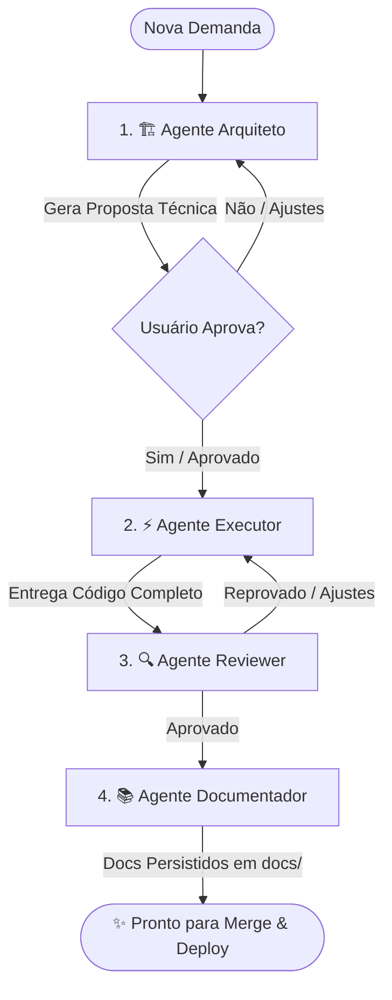

# 🤖 Agentes Especialistas & Skills - Team Pulse Hub (Node.js + Next.js + TypeScript)

Este diretório contém a suíte de agentes especialistas e skills de engenharia de software configurados especificamente para a stack do projeto **`Team_Pulse_Hub`**.

---

## 🛠 Stack Tecnológica do Projeto

- **Full-Stack Framework:** [Next.js](https://nextjs.org/) (App Router com Server Components, Route Handlers `/api` e Server Actions)
- **Runtime & Linguagem:** [Node.js](https://nodejs.org/) (LTS) + [TypeScript](https://www.typescriptlang.org/) (Strict Mode)
- **Camada de Dados & ORM:** [Prisma ORM](https://www.prisma.io/) com banco de dados relacional [PostgreSQL](https://www.postgresql.org/)
- **Validação & Schemas:** [Zod](https://zod.dev/) para tipagem e validação de payloads HTTP, DTOs e variáveis de ambiente
- **Filas & Processamento Assíncrono:** [BullMQ](https://docs.bullmq.io/) integrado com [Redis](https://redis.io/)
- **Estilização & UI:** [Tailwind CSS](https://tailwindcss.com/), [Lucide React](https://lucide.dev/), componentes acessíveis e design moderno
- **Testes & Qualidade:** [Vitest](https://vitest.dev/) / Testing Library, mocks tipados de repositórios e serviços

---

## 👥 Agentes Disponíveis

| Agente | Arquivo | Função Principal |
| :--- | :--- | :--- |
| **🏗️ Agente Arquiteto** | [`AGENTE_ARQUITETO.md`](./AGENTE_ARQUITETO.md) | Analisa demandas, planeja modelos de dados Prisma (`schema.prisma`), rotas de API (Route Handlers/Server Actions), schemas Zod, jobs assíncronos (BullMQ) e telas/componentes Next.js. **Bloqueia execução até aprovação.** |
| **⚡ Agente Executor** | [`AGENTE_EXECUTOR.md`](./AGENTE_EXECUTOR.md) | Escreve código de produção 100% completo, estritamente tipado em TypeScript, modular e funcional em Next.js App Router, Prisma e Tailwind CSS, sem omissões. |
| **🔍 Agente Reviewer** | [`AGENTE_REVIEWER.md`](./AGENTE_REVIEWER.md) | Audita segurança (OWASP), tipagem TypeScript (sem `any`), Server/Client boundaries, queries Prisma (prevenção N+1, índices), tratamento de erros e integridade do banco. |
| **📚 Agente Documentador** | [`AGENTE_DOCUMENTADOR.md`](./AGENTE_DOCUMENTADOR.md) | Gera e mantém a documentação técnica, TSDoc, catálogo de rotas/ações, schemas de dados e documentações modulares persistidas no diretório `docs/`. |

---

## 📐 Skills Disponíveis

- **`nextjs-typescript-architecture`** ([`skills/nextjs-typescript-architecture/SKILL.md`](./skills/nextjs-typescript-architecture/SKILL.md)): Padrões arquiteturais para Clean Architecture no Next.js App Router, TypeScript estrito, Prisma ORM, Zod, BullMQ, Tailwind CSS e regras rígidas de isolamento de banco de dados em testes.

---

## 🔄 Ciclo de Desenvolvimento Recomendado

---

## 🚀 Como Invocar os Agentes

Você pode direcionar qualquer prompt no chat mencionando o agente desejado:

1. **Para planejar uma nova funcionalidade:**
   > *"Atue como o **Agente Arquiteto** e planeje o módulo de gerenciamento de membros da equipe."*

2. **Para gerar o código aprovado:**
   > *"Plano aprovado! Atue como o **Agente Executor** e implemente todos os arquivos da funcionalidade."*

3. **Para auditar a implementação:**
   > *"Atue como o **Agente Reviewer** e faça a auditoria completa de segurança, performance Prisma e padrões TypeScript do código acima."*

4. **Para registrar e documentar:**
   > *"Atue como o **Agente Documentador** e gere a documentação técnica completa do módulo em `docs/`."*
